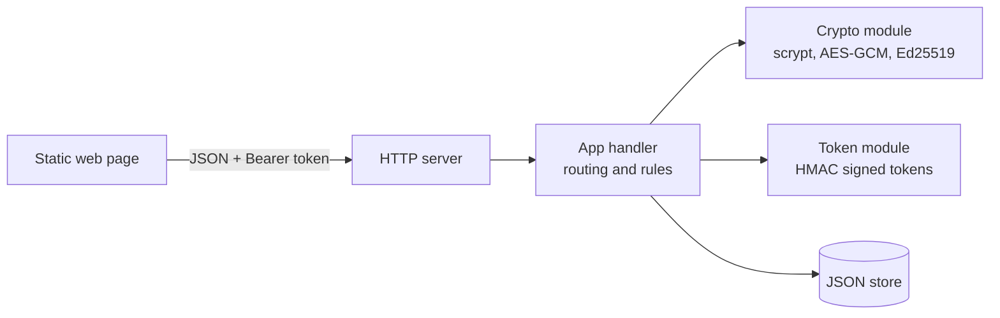
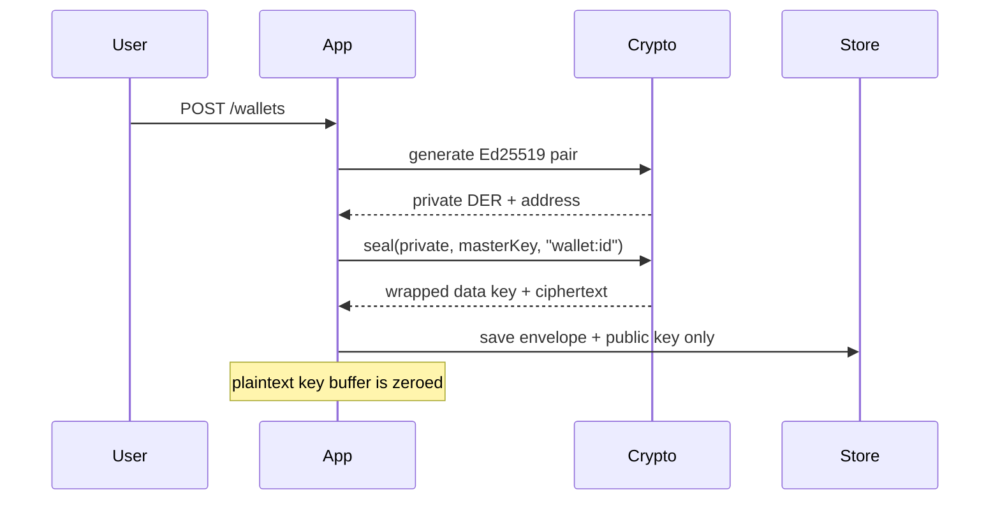
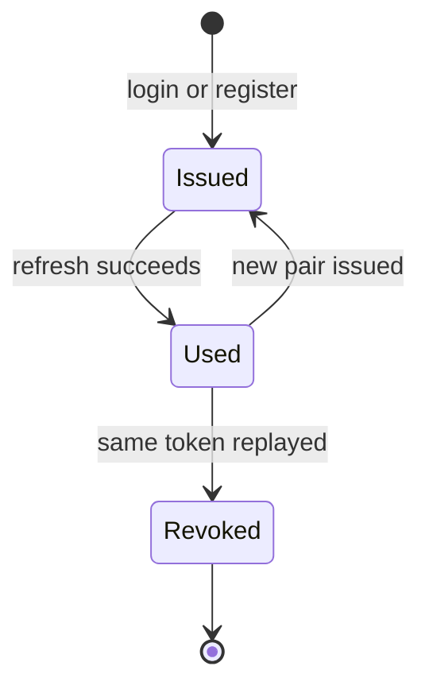

# KeyVault

Dependency-free reference for how a **custodial key vault** can work: envelope-encrypted private keys, rotating refresh tokens with reuse detection, and signed ledger transfers between wallets

It is an **educational demo**. Wallets use Ed25519 keys and an internal ledger, not a real blockchain, and the JSON file store is not meant for production

## Highlights

| Concept | How it is done here |
| --- | --- |
| Password storage | scrypt with a random 16-byte salt per user |
| Key protection | Envelope encryption: a fresh data key per wallet, wrapped by a master key, AES-256-GCM, wallet id bound as AAD |
| Sessions | Short-lived access tokens plus single-use refresh tokens; replaying a used token revokes the whole session family |
| Transfers | Each ledger entry is signed by the sender's key and re-verified when history is read |
| Abuse control | Per-IP rate limit on register and login, request size cap |
| Footprint | Node 20+ only, zero npm dependencies |

## Architecture



## Key lifecycle



## Refresh rotation


## Run it

```bash
export VAULT_MASTER_KEY=$(openssl rand -hex 32)
export TOKEN_SECRET=$(openssl rand -hex 32)
npm start            # http://localhost:4000
npm test             # 8 tests
```

Keep `VAULT_MASTER_KEY` safe: losing it makes stored wallets unrecoverable, and there is intentionally no built-in default

## API

| Method | Path | Purpose |
| --- | --- | --- |
| POST | `/auth/register`, `/auth/login` | Create account or sign in |
| POST | `/auth/refresh`, `/auth/logout` | Rotate tokens, end sessions |
| POST | `/wallets` | Create a wallet |
| GET | `/wallets` | List your wallets |
| POST | `/wallets/:id/faucet` | Add 100 test units |
| POST | `/wallets/:id/sign` | Sign a message |
| POST | `/wallets/:id/transfer` | Send units to an address |
| GET | `/wallets/:id/history` | Signed entries with verification flag |

## Layout

```text
src/crypto.js   password hashing, envelope encryption, signatures
src/tokens.js   signed token helpers
src/store.js    JSON persistence
src/app.js      routes and business rules
src/server.js   HTTP wiring
public/         single-page UI
test/           node:test suite
```

## Production gaps

Replace the JSON store with a database, move the master key into a KMS or HSM, add audit logging, and add real chain integration before handling anything of value
